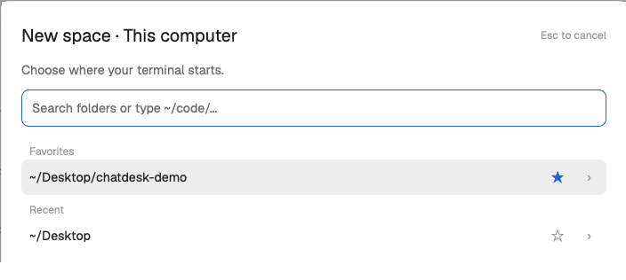

# Herdr Chatdesk

A project-first Herdr window: the left sidebar is a tree of spaces → sessions → sub-agents, the right side flips between an agent's chat and its real terminal, and New space asks for a folder and then for the session to start there.


## What it adds

- **Chat / Terminal in place.** On a Claude Code, Codex, Pi or Antigravity pane, the header's switch parks the terminal (it keeps running) and shows the conversation in the main pane; Terminal brings it back.
- **Projects on the left.** Machines → spaces → sessions → helpers, with blocked / working / done / idle marks and a fold per space.
- **Sub-agent tree.** Helpers started by a lead agent nest under its session, however deep.
- **New space, then session.** The `+` on a machine header picks a folder, then asks whether to start an agent (installed on that machine) or a plain terminal.

### The new-space flow




## Install

```text
Read ~/.config/herdr-app/AGENTS.md, then add this layout: herdr.dev/layouts/YouAI-Liu/herdr-chatdesk
```

After adding it, switch with `herdr-app do layout.switch --name chatdesk` (or the layout switcher).

The layout is `layouts/chatdesk.json`; the mods it needs are in `mods/`. The full brief is in [RECIPE.md](RECIPE.md).

## Credits

Built on [Shepherdr](https://github.com/eliasstravik/shepherdr) by Elias Stravik (MIT): `chat`, `chat-models`, `chat-react`, `chat-image` and `pane-chat` are modified from it. See `LICENSE-Shepherdr` and `NOTICE`. Parts derived from Herdr are Apache 2.0 (`LICENSE-Herdr`).
