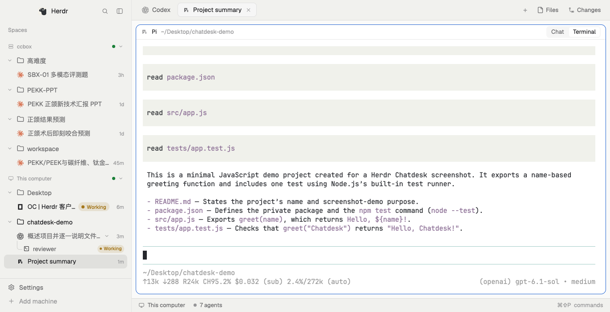
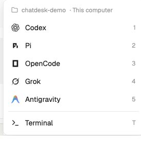

# Herdr Chatdesk

A project-first layout for Herdr: every project is a space, every session and sub-agent sits in one tree, and any agent can flip between a readable chat and its real terminal. New space is a two-step folder → session flow.

## Highlights

1. **Chat ↔ Terminal, in place.** Flip a Claude Code, Codex, Pi or Antigravity pane between its real terminal and a readable chat. The agent keeps running while Chat is open; Terminal brings it back in the same spot.
2. **Sub-agents in a tree.** A lead agent's helpers nest under its session, with working / waiting / done marks, so a project's whole agent tree is visible at a glance.
3. **New space in two steps.** The `+` on a machine picks a folder, then an installed agent or a plain terminal. Esc cancels without creating anything; the folder stays in Recents.



## The window

On the left, machines → spaces → sessions → helpers. On top, tabs with status and the Files / Changes buttons. In the middle, the chat or the real terminal. On the right, an optional panel. The sidebar is 268px, the tab bar 42px, the status bar 28px; the side panel is 368px and stays hidden until opened.

### The new-space flow




## Install

```text
Read ~/.config/herdr-app/AGENTS.md, then add this layout: herdr.dev/layouts/YouAI-Liu/herdr-chatdesk
```

After adding it, switch with `herdr-app do layout.switch --name chatdesk` (or the layout switcher).

The layout is `layouts/chatdesk.json`; the mods it needs are in `mods/`. The full brief is in [RECIPE.md](RECIPE.md).

## Credits

Built on [Shepherdr](https://github.com/eliasstravik/shepherdr) by Elias Stravik (MIT): `chat`, `chat-models`, `chat-react`, `chat-image` and `pane-chat` are modified from it. See `LICENSE-Shepherdr` and `NOTICE`. Parts derived from Herdr are Apache 2.0 (`LICENSE-Herdr`).
