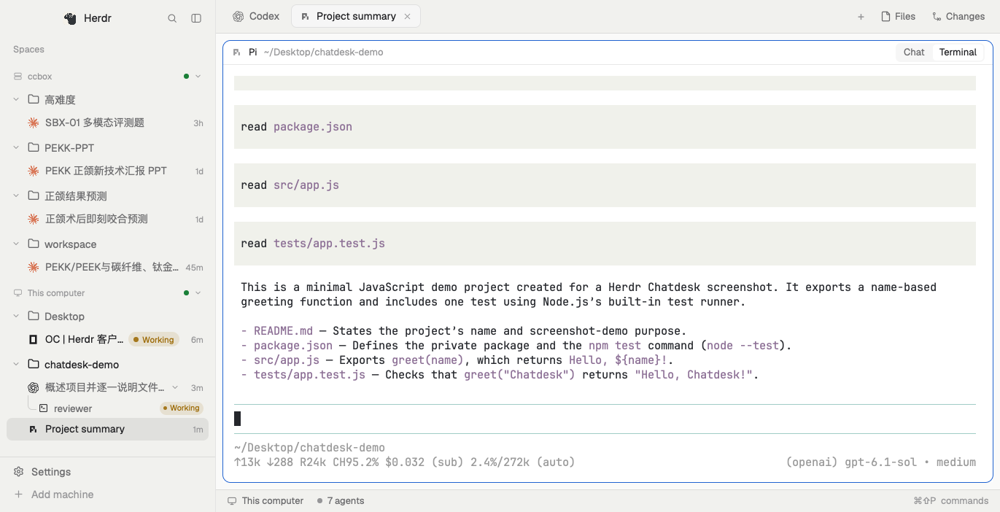
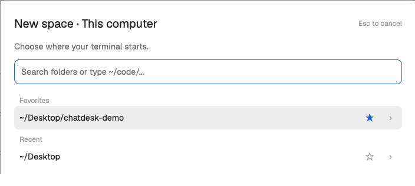
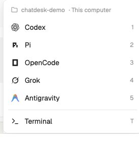

# Herdr Chatdesk

A project-first Herdr window: the left sidebar is a tree of spaces → sessions → sub-agents, the right side flips between an agent's chat and its real terminal, and New space asks for a folder and then for the session to start there.

## Highlights

1. **Chat ↔ Terminal, in place.** Flip a Claude Code, Codex, Pi or Antigravity pane between its real terminal and a readable chat; the agent keeps running while Chat is open.
2. **Sub-agents in a tree.** Helpers nest under the session that started them, with working / waiting / done marks.
3. **New space in two steps.** Pick a folder, then an installed agent or a plain terminal. Esc creates nothing; the folder stays in Recents.



## What you see

A 268px sidebar, a 42px tab bar, the main pane, an optional 368px side panel and a 28px status bar.

**Sidebar, top to bottom**

- A 46px brand row (the shipped `workspace-chrome` logo), then the **Spaces** heading.
- Machines as headers: a monitor icon for this computer, a server icon for another machine, a fold chevron, a connection dot, and a `+` on hover that starts a new space there.
- Under each machine, one row per space: folder icon, name, and a count of its sessions; a `+` on hover adds a session to that space. Right-click opens the space menu (rename, close, color, and so on).
- Under an open space, one row per session: the lead agent's icon, a short title, its status mark, and how long ago it changed. A session that started a helper shows that helper nested under it, with a tree line. A helper can start another; the nesting goes as deep as the agents do.
- A session's status is a dot (blocked or done), a spinner (working) or a ring (idle). A folded space shows the strongest status of its sessions instead.
- The footer is the shipped `workspace-chrome` footer (Settings, Add machine).

**Tab bar**

- One tab per session, with the program's icon, name, status mark and a close button on the active tab.
- `+` opens the shipped `new-menu` (Terminal / agents / New space).
- **Files** and **Changes** buttons open the side panel on the right; the panel remembers its choice per space and starts closed.

**Main pane**

- A stack with two children: `main-chat` (the `chat` mod) and `main-term` (the active terminal, with a `pane-chat` header).
- The pane header is 30px: program icon, agent or terminal title, folder, status, then **Chat | Terminal** on the right, and split / zoom / close buttons.
- On a Chatdesk-sized window the header's toggle switches the whole main stack, so the chat gets the full width instead of a narrow split.

**Side panel**

- Files (the shipped `files` panel) and Changes (the shipped `changes` panel), in a 368px column, hidden until opened.

## How it behaves

### Chat / Terminal

- The **Chat | Terminal** switch appears in the pane header of agents whose conversation the chat can read: Claude Code, Codex, Pi and Antigravity. Other agents keep the Terminal side.
- **Chat** parks the agent's terminal (it keeps running without a pane) and shows the conversation in `main-chat`, read from the agent's own session log. The box at the bottom writes to the agent; tool calls, questions, diffs and sub-agent reports appear in the timeline.
- **Terminal** brings the terminal back and leaves the chat.
- The chat has its own header with the agent, folder, status and the same Chat / Terminal switch.
- The chat's model button opens `chat-models` to restart the agent with another model. The chat also opens `chat-image` for image attachments and `chat-react` for reactions.
- OpenCode and other agents without a readable session log show a "No chat for this agent" card with an **Open terminal** button; the Terminal side works normally.

### The project tree

- A **space** is a project (a repo or folder). A **session** is the tab's lead agent. Helpers that the lead starts with `hc run --bg` (or an agent's own sub-agent tool) nest under it.
- The tree uses the core's `parent` link, or the `herdr.parent=<address>` label when an agent is started without a parent, so helpers show up even when they were started from inside an agent.
- Clicking a session or helper focuses its pane. Right-clicking opens the tab or space menu.
- Spaces and sessions are sorted: waiting on you first, then working, then the rest; within a group, the latest change first.
- Fold state is kept in `localStorage` (`folded`), so the tree opens the way you left it.

### New space

- The machine header's `+` opens `space-new`: a 640×560 folder dialog with search, favorites and recents, scanned by `folders.py` with Python 3.

  

- Choosing a folder opens the `session-new` popup, 250×300: the machine's installed agents (from `knownAgents`) plus **Terminal**. The popup's header shows the chosen folder and the machine.

  
- Picking an agent creates the space with `space.new { folder, machine, tab: agent.name, argv: agent.run }`; picking Terminal creates it with the folder only. Esc closes the popup without creating anything; the folder stays in Recents.
- The `+` on a space row opens the same popup for that space and adds a tab instead of a space.

### Tabs, panels, status

- Tabs switch, rename (double-click), reorder (drag), and close. Status comes from the agent's OSC 7501 report or the title fallback.
- Files and Changes open in the side panel and are remembered per space.
- The status bar is the shipped `workspace-status`; the footer is the shipped `workspace-chrome` footer.

## Built from

**Layout**: `layouts/chatdesk.json`, a row of `sidebar` (268px) and `work`.

```
root row
├─ sidebar column (268, chrome background)
│  ├─ brand            block  workspace-chrome           46px
│  ├─ sidebar-lists    column
│  │  └─ session-tree  block  session-tree               weight 1
│  └─ sidebar-footer   block  workspace-chrome (footer)  69px
└─ work column
   ├─ tabs row (42px)
   │  └─ tab-bar       block  tabs-chat                  weight 1
   ├─ work-body row
   │  ├─ main stack (active: main-chat)
   │  │  ├─ main-chat  block  chat (props: standalone)
   │  │  └─ main-term  block  tab: active, pane header: pane-chat (30px)
   │  └─ panel column (368px, hidden)
   │     └─ panel-body stack (active: files)
   │        ├─ files    block  files
   │        └─ changes  block  changes
   └─ status           block  workspace-status          28px
```

**Mods** (this folder)

- `session-tree` — the left tree: machines, spaces, sessions, sub-agents, statuses, menus.
- `tabs-chat` — the tab bar with chat-aware status, panel buttons and window buttons.
- `pane-chat` — the pane header and the Chat / Terminal switch; parks and restores terminals; swaps the `main` stack.
- `chat` — the conversation view and composer; reads agent session logs; sends messages to the agent's terminal.
- `chat-models` — model picker used by the chat to restart an agent.
- `chat-react` — reaction picker used by the chat.
- `chat-image` — image attachment viewer used by the chat.
- `space-new` — the folder picker for a new space on a chosen machine (`folders.py`, Python 3).
- `session-new` — the agent / terminal picker shown after a folder is chosen, and from a space row's `+`.

**Shipped mods used, not included**: `workspace-chrome` (brand and footer), `workspace-status` (status bar), `files`, `changes`, `menu`, `new-menu`.

**Herdr functions**: `spaces`, `panes`, `terminals`, `focused`, `run`, `openOverlay`, `closeOverlay`, `layout`, `shared` / `setShared`, `knownAgents`, `exec`, `hc`, `pickFolder`, `theme`, `window`, `props`, `nextCommand`, `watchFolder`, `localStorage`.

**No `keys.json`**: everything is a click. The Chat / Terminal switch is in the pane header; the tree's `+` buttons are on hover.

## Watch out

- **Based on Shepherdr.** `chat`, `chat-models`, `chat-react`, `chat-image` and `pane-chat` are modified from [Shepherdr](https://github.com/eliasstravik/shepherdr) by Elias Stravik (MIT). The standalone chat mode, the session tree, the tab bar and the New space flow are Chatdesk's changes. Keep `LICENSE-Shepherdr` and `NOTICE` when you copy these files.
- **The chat reads files and drives terminals.** It reads the agent's own session log (Claude Code, Codex, Pi, Antigravity) and uses `hc` / `herdr-app do` to read, park, keep and message terminals. The agent keeps running while its pane is parked. Nothing is uploaded by the chat itself.
- **Optional voice and dictation.** The chat's voice call and dictation helpers are off unless you configure them; they use a local helper and can call ElevenLabs or OpenAI with keys you provide. Don't enable them if you don't want that.
- **Python 3 for the folder picker.** `space-new/folders.py` scans folders; on a remote machine that machine needs `python3`. Without it the picker shows a runtime error.
- **Shepherdr's Settings and Accept cards are not included.** The chat and terminal flows don't need them, but buttons that open `shepherdr-settings` or `accept-card` (Settings › Secrets, Accept/Review in the task news) have no target in this bundle.
- **Chat is per agent type.** OpenCode, Gemini and other agents without a readable session log show the terminal side only.
- **A wide window helps.** The sidebar is 268px and the side panel 368px; below ~1000px the main pane gets tight. The sidebar can be narrowed or hidden with the shipped layout tools.
- **No usage meter, no Insights.** This bundle deliberately leaves out `usage-status` and `insights`.

## Done when

- `herdr-app check mods/session-tree`, `tabs-chat`, `pane-chat`, `chat`, `chat-models`, `chat-react`, `chat-image`, `space-new`, `session-new` all pass.
- `layout.switch { name: "chatdesk" }` shows the sidebar, tab bar and main pane above.
- The machine header's `+` goes folder → agent/Terminal → a new space; Esc at the popup creates nothing.
- A space row's `+` adds an agent or terminal tab to that space.
- With a Claude Code or Codex tab active, Chat shows the conversation and Terminal restores the terminal; the agent keeps running in both.
- A helper started from the lead agent shows nested under its session; clicking it focuses its pane.
- Files and Changes open the side panel and remember the choice per space.

## Files

- `RECIPE.md`
- `preview.png`, `new-space.png`, `new-session.png`
- `LICENSE`, `LICENSE-Shepherdr`, `LICENSE-Herdr`, `NOTICE`
- `layouts/chatdesk.json`
- `mods/session-tree/`
- `mods/tabs-chat/`
- `mods/pane-chat/`
- `mods/chat/`
- `mods/chat-models/`
- `mods/chat-react/`
- `mods/chat-image/`
- `mods/space-new/`
- `mods/session-new/`
